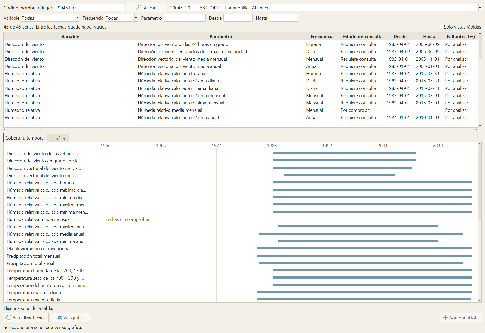
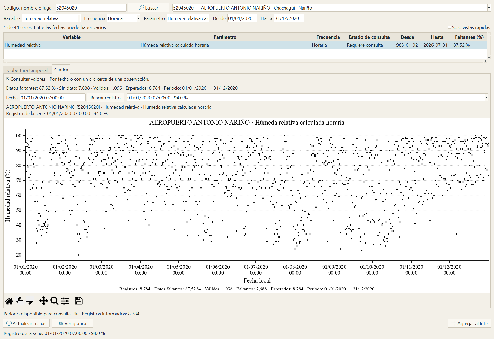
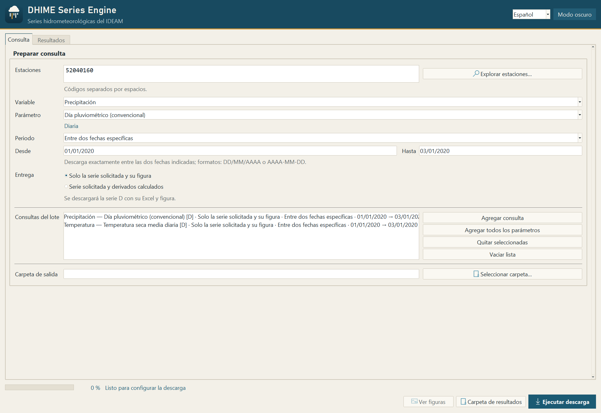
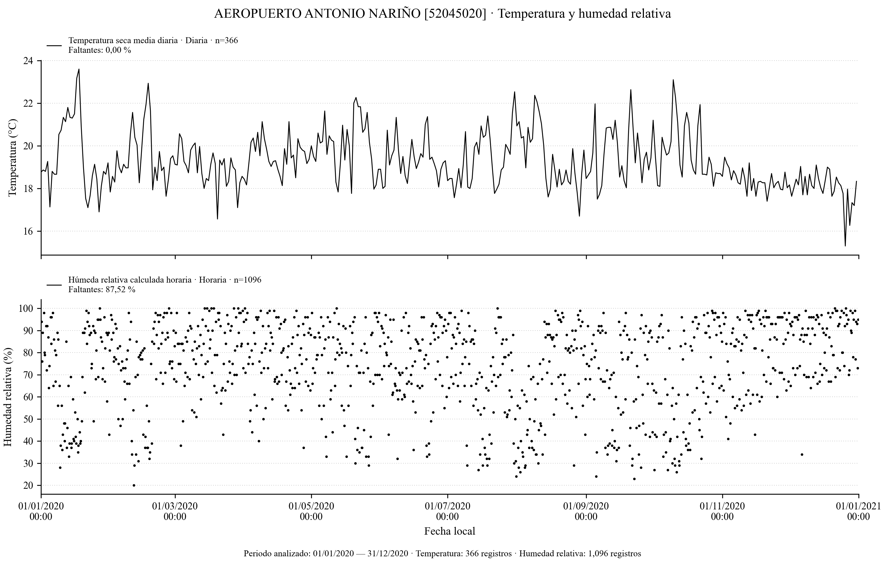
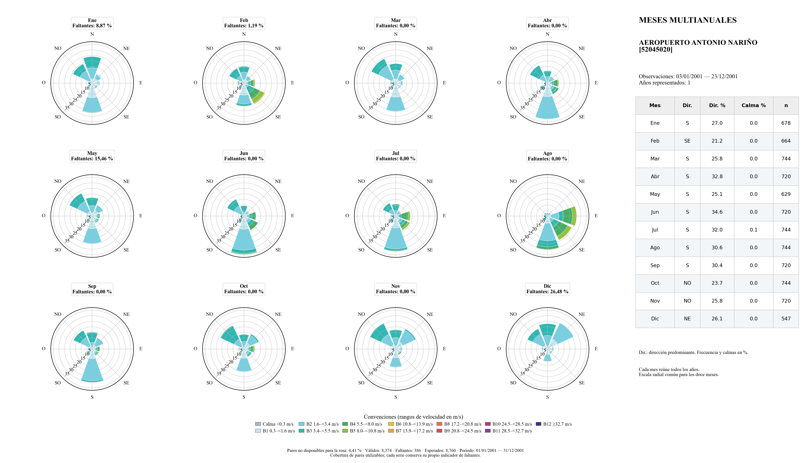

# DHIME Series Engine

Aplicación de escritorio para revisar y descargar series hidrometeorológicas del IDEAM (Colombia) por estación, parámetro y periodo.

Versión 1.0.0, para Windows de 64 bits.

## Para qué sirve

Antes de descargar una serie conviene saber si la estación la tiene, desde cuándo y con cuántos vacíos. DHIME Series Engine muestra eso primero y descarga después.

- Busca estaciones por código, nombre o municipio.
- Lista las series de cada estación con su frecuencia y sus fechas inicial y final. Si el índice incluido no trae las fechas de alguna, las consulta al IDEAM en ese momento.
- Grafica la serie del periodo que elijas e informa el porcentaje de datos faltantes.
- Descarga los datos originales en CSV y ZIP, con un Excel y una figura por serie.
- Reúne consultas de varias estaciones en un lote y las descarga juntas.
- Dibuja rosas de viento cuando hay velocidad y dirección de la misma estación y periodo.

Trabaja con precipitación, temperatura, humedad relativa, velocidad y dirección del viento, caudal, nivel y brillo solar. Lo que hay para cada estación depende de lo que el IDEAM publique.

Los valores se guardan como llegan. La aplicación no rellena ni interpola. Los agregados que calcula ella misma solo se generan si los pides y quedan marcados como «Calculado».

## Instalación

1. Descarga [DHIME_Series_Engine_1.0.0_Instalador.exe](https://github.com/RiveraEngineer/DHIME-Series-Engine/releases/latest/download/DHIME_Series_Engine_1.0.0_Instalador.exe) (84.9 MB).
2. Ejecútalo y sigue el asistente. Se instala en tu usuario, sin permisos de administrador y sin instalar Python.
3. Abre DHIME Series Engine desde el menú Inicio.

Ocupa cerca de 260 MB instalado. Necesita Internet para consultar al IDEAM. Si el servicio directo no responde, la aplicación abre el portal del IDEAM en Google Chrome como respaldo, así que conviene tenerlo instalado.

El instalador no tiene firma digital de editor, por lo que Windows puede mostrar el aviso «Windows protegió su PC». En [docs/INSTALACION.md](docs/INSTALACION.md) está cómo comprobar que el archivo es el publicado aquí y cómo continuar.

SHA-256 del instalador

    c79ab84f18fc8469c2834cd0a5ee07d760dde6b84fd3b8666a967a8ac023d12e

Si ya la tenías instalada, ciérrala y ejecuta este instalador encima. Tus descargas no se tocan.

Cuando se publique una versión nueva, la aplicación lo avisa al abrir con un botón en la franja superior que lleva a la página de descarga. No descarga ni instala nada por su cuenta.

## Uso

1. Pulsa «Explorar estaciones…», escribe un código o un nombre y pulsa «Buscar».
2. Elige una serie, pon las fechas y pulsa «Ver gráfica» para revisar cuántos datos tiene.
3. Pulsa «Agregar al lote». Repite con otras series o estaciones si quieres.
4. De vuelta en la ventana principal, elige la carpeta de salida y pulsa «Ejecutar descarga».

Al terminar, la pestaña «Resultados» abre la carpeta y las figuras. Cada descarga deja esto

    01_Datos_Crudos_DHIME/    CSV y ZIP tal como los entrega el IDEAM
    02_... a 05_...           Excel y figuras, según la resolución pedida
    RESULTADOS.html           índice de lo descargado

También puedes escribir los códigos de estación directamente en la ventana principal, sin pasar por el visor.

## Figuras

Cada serie descargada trae su figura. Si pides temperatura y humedad de la misma estación, puedes obtener además una figura conjunta. Con velocidad y dirección del viento se generan rosas, incluida una malla con los doce meses del periodo.

## Video

Un recorrido de un minuto por la aplicación.

https://github.com/user-attachments/assets/db24d11e-67df-428e-9836-8e8bad9cd8db

## Cosas que conviene saber

- Las fechas «Desde» y «Hasta» del visor son las que reporta el IDEAM para la serie. Entre ellas puede haber vacíos. El porcentaje de faltantes se calcula al abrir la gráfica.
- El instalador trae un índice con las fechas de 69,729 series en 6,376 estaciones, para que la búsqueda funcione sin esperar. Si una estación o una serie no está en el índice, se consulta al IDEAM en ese momento. También puedes buscar por código una estación que no figure en el catálogo incluido.
- Los temporales se borran al cerrar. Si la aplicación se interrumpe, los que queden se retiran en un arranque posterior.
- Cuando el IDEAM anuncia una serie pero no la entrega, la descarga queda registrada como error del servicio y no como serie vacía.
- Los modos Decadal y Multianual del portal no están incluidos.
- Solo hay instalador para Windows de 64 bits. No se ha probado en macOS ni Linux.

Qué se probó y qué sigue pendiente está en [docs/VALIDACION.md](docs/VALIDACION.md). Lo que trae cada versión está en [CAMBIOS.md](CAMBIOS.md).

## Problemas y sugerencias

Si algo no carga o un resultado no cuadra, abre un [issue](https://github.com/RiveraEngineer/DHIME-Series-Engine/issues) con el código de la estación, el parámetro y las fechas. Una captura o el texto del error ayudan mucho.

## Cómo citar

Si la usas en una tesis, un informe o un artículo, puedes citarla así

> Rivera Monroy, S. A. (2026). *DHIME Series Engine* (Versión 1.0.0) [Software]. GitHub. https://github.com/RiveraEngineer/DHIME-Series-Engine

Los datos se citan aparte, con el IDEAM como fuente. En [CITAR.md](CITAR.md) están el formato BibTeX y un modelo para citar las series descargadas. El botón «Cite this repository» de esta página entrega la misma referencia en APA y BibTeX.

## Autoría, datos y licencia

Desarrollado por Sergio Alejandro Rivera Monroy ([ORCID 0009-0003-5470-8856](https://orcid.org/0009-0003-5470-8856)).

Los datos son del IDEAM y se consultan en sus servicios públicos. Este proyecto es independiente del Instituto. Las bibliotecas que usa la aplicación y los proyectos que se revisaron como antecedentes están reconocidos en [CREDITOS.md](CREDITOS.md).

En este repositorio se publica el instalador con su documentación; el código fuente no está incluido. La aplicación y la documentación se distribuyen con [licencia MIT](LICENSE). Los datos y los componentes de terceros conservan sus propias condiciones.
